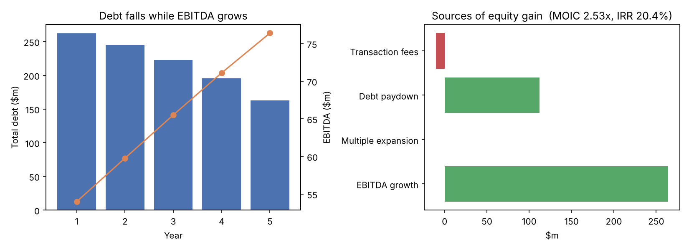

# LBO Model in Python

A simple leveraged buyout (LBO) model that projects a private equity deal over five years, pays down debt with a cash sweep, and calculates the sponsor's **IRR** and **MOIC**. It also breaks the equity gain into **EBITDA growth, debt paydown, and multiple expansion**, and shows how returns change with different exit multiples and leverage.

The company and numbers are hypothetical and are meant to show how the mechanics work.



## The deal

| | |
|---|---|
| Company | TargetCo, a hypothetical mid-market business services company |
| Entry | $50m EBITDA at 10.0x, so a $500m purchase price |
| Financing | 4.0x senior debt (8%), 1.5x subordinated notes (11%), $240m sponsor equity |
| Plan | 5–8% revenue growth, EBITDA margin from 20% to 22% |
| Exit | Year 5 at 10.0x EBITDA (no multiple expansion assumed) |

## Results

| Metric | Value |
|---|---|
| Sponsor equity invested | $240.0m |
| Exit EBITDA | $76.4m |
| Equity value at exit | $606.3m |
| **MOIC** | **2.53x** |
| **IRR** | **20.4%** |
| Debt / EBITDA | 5.5x at entry, 2.1x at exit |

**Where the $366m equity gain came from:**

| Driver | $m |
|---|---|
| EBITDA growth | 264.0 |
| Debt paydown | 112.3 |
| Multiple expansion | 0.0 |
| Transaction fees | (10.0) |

Most of the return comes from growing EBITDA. Debt paydown adds about a third, since the company's own cash flow pays down roughly $112m of debt. Because the exit multiple equals the entry multiple, none of the return depends on selling at a higher price.

## IRR sensitivity

Rows are total entry leverage (Debt/EBITDA), and columns are exit multiples.

| | 8.0x | 9.0x | 10.0x | 11.0x | 12.0x |
|---|---|---|---|---|---|
| 4.5x | 12.4% | 15.5% | 18.3% | 20.9% | 23.3% |
| 5.0x | 12.9% | 16.3% | 19.3% | 22.0% | 24.5% |
| 5.5x | 13.6% | 17.2% | **20.4%** | 23.3% | 25.9% |
| 6.0x | 14.3% | 18.2% | 21.7% | 24.7% | 27.5% |
| 6.5x | 15.5% | 19.7% | 23.4% | 26.6% | 29.6% |

More debt raises IRR because the sponsor puts in less equity. The exit multiple has the bigger effect: selling at 8.0x instead of 10.0x cuts IRR by about 7 points.

## How the model works

1. **Sources & Uses:** the purchase price plus fees and minimum cash is funded by senior debt, subordinated notes, and sponsor equity.
2. **Projections:** revenue, EBITDA, D&A, capex, and working capital for each year.
3. **Free cash flow:** net income + D&A − capex − increase in working capital.
4. **Debt schedule:** interest is charged on the opening balance. Senior debt is repaid first by a mandatory 5% per year, and any leftover cash then sweeps against it. Subordinated notes are repaid at exit.
5. **Returns:** exit enterprise value − debt + cash = equity value, which gives MOIC and IRR.
6. **Returns bridge:** splits the equity gain into its drivers, with a check that the parts add up to the total.

## Run it

```bash
pip install -r requirements.txt
python lbo.py
```

To try a different deal, change the assumptions in `inputs.yaml`. The script prints every schedule and saves `output/lbo_model.xlsx` and `output/lbo_summary.png`.

## Simplifications

- Interest is calculated on opening balances to avoid circular references.
- There is no dividend recap, management rollover, or debt refinancing.
- Taxes are a flat rate on positive pre-tax income.
- The company is hypothetical, and the assumptions are illustrative.

## Next steps

- Add a management option pool and a preferred equity tranche
- Pull real company financials and run the model on a public take-private example
- Build a small web front end to change inputs interactively

---
Built by Safiullah Safdariyan (Cornell University).
